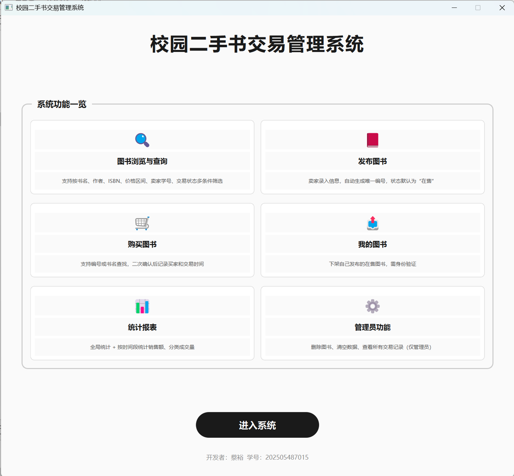
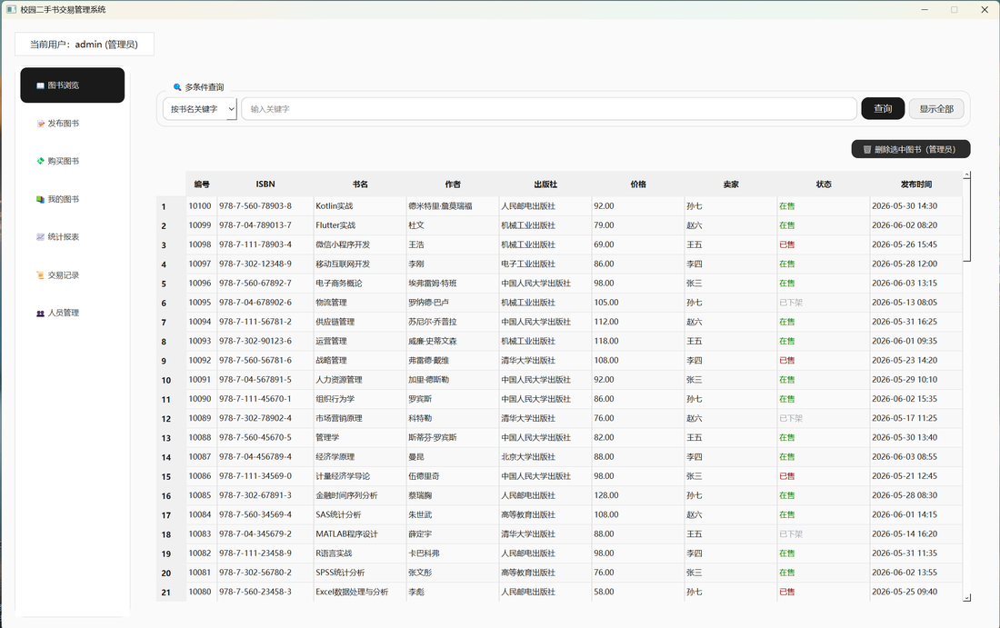
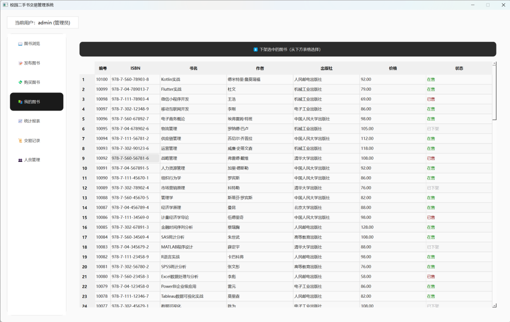
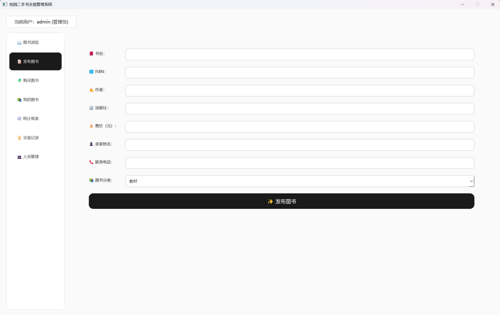
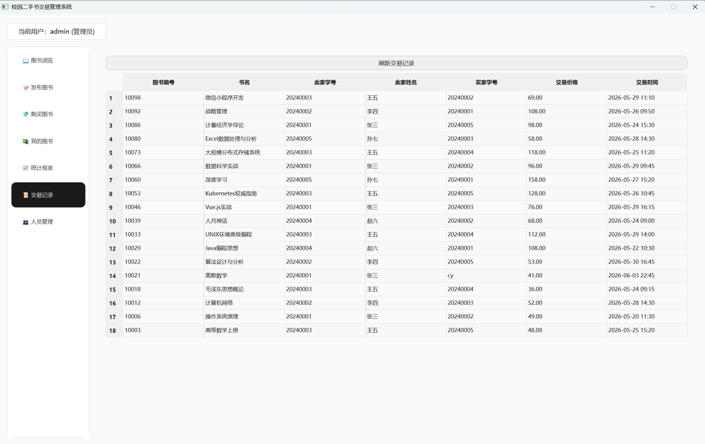
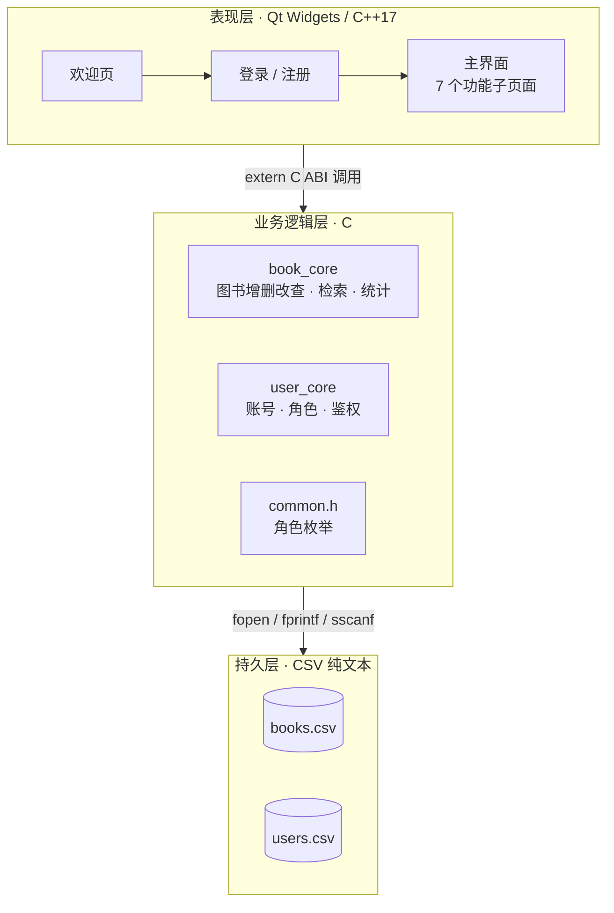

# 校园二手书交易管理系统

> 《C 语言程序设计 2》课程设计 · 湘潭大学计算机学院 · 2025 级软件工程
> **C + C++/Qt 混合编译** · 动态链表 + CSV 持久化 · 零数据库依赖 · 2178 行源码



## 这是什么

一个面向校园场景的二手图书流转系统。**Qt Widgets 做界面，核心业务全部用 C 写**，两边通过 `extern "C"` 混编；数据用两份 CSV 文件持久化，不装数据库，程序拷走就能跑。

- **8 项必做 + 3 项选做任务全部完成**，自评成绩「良」
- **37 条测试用例全部通过**（导入 8 / 查询 8 / 购买 8 / 下架 7 / 人员管理 6）
- 双角色权限：管理员 / 普通用户，页面级 + 功能级 + 数据级三层管控

## 功能

| 模块 | 能力 |
|---|---|
| 欢迎页 | 六大功能卡片总览，一键进入系统 |
| 登录 / 注册 | 账号查重、密码校验、角色识别，自动初始化默认管理员 |
| 图书浏览 | 多条件组合查询：书名 / 作者 / ISBN / 卖家 / 状态 / 价格区间 |
| 发布图书 | 自动生成唯一编号、绑定卖家、记录上架时间，默认「在售」 |
| 购买图书 | 仅限在售；禁止购买本人书籍；成交后写入买家 ID 与交易时间 |
| 我的图书 | 只看自己发布的；在售可下架，已售 / 已下架锁定操作 |
| 统计报表 | 全局汇总 + 自定义时间段统计 + 四分类成交，可导出 TXT 报表 |
| 交易记录 | 全量成交清单，普通用户只读，管理员可查全平台 |
| 人员管理 | 管理员专属：增删账号、改密码、切换角色，默认管理员防删 |
| 数据运维 | 批量导入 / 导出 CSV、一键清空测试数据 |

### 课程任务对照

| 序号 | 任务 | 状态 |
|---|---|---|
| A–H | 欢迎界面、动态链表、发布、购买、下架、多条件查询、时间段统计、文件保存 | 全部完成 |
| 1 | 人员管理界面管理用户 | 完成 |
| 2 | 图形菜单界面 | 完成 |
| 3 | 买卖双方信息录入核验 | 完成 |

## 界面

**图书浏览 · 六条件组合查询，状态下用颜色区分在售 / 已售 / 已下架**



**我的图书 · 在售可下架，已售与已下架锁定操作**



**发布图书 · 自动生成编号、绑定卖家、默认在售**



**交易记录 · 全量成交清单，买家 ID 与成交时间自动归档**




## 架构



三层单向调用：界面只调函数，不碰数据；业务层不认界面，只管链表和文件；持久层就是两份 CSV。

### 数据模型

| books.csv | 说明 |
|---|---|
| `book_id` | 主键，自增（从 10001 起） |
| `isbn` `book_name` `author` `publisher` | 书目信息 |
| `price` | 售价（元） |
| `seller_id` `seller_name` `seller_phone` | 卖家信息，发布时绑定当前登录账号 |
| `status` | `0` 在售 · `1` 已售 · `2` 已下架 |
| `publish_time` `buyer_id` `trade_time` | 上架时间、买家 ID、成交时间 |
| `category` | 分类（1–4） |

| users.csv | 说明 |
|---|---|
| `username` `password` | 账号密码 |
| `role` | `0` 普通用户 · `1` 管理员 |

## 几个值得说的实现

**1. C / C++ 混合编译。** 业务层是 `.c`，界面层是 `.cpp`。C++ 编译器会对函数名做 name mangling，直接包含 C 头文件会导致链接器找不到符号。解法是把 C 头文件的声明用 `extern "C"` 包起来：

```c
#ifdef __cplusplus
extern "C" {
#endif

void init_list();
int  add_book(Book book);
Node* query_books_by_condition(int type, const char* keyword,
                               float min_price, float max_price);

#ifdef __cplusplus
}
#endif
```

**2. 链表 + 全量落盘。** 内存里用带头结点的单向链表承载全部图书，`malloc/free` 手工管理。启动时 `load_from_csv` 重建链表，任何增删改后立刻 `save_to_csv`，所以不存在"没保存就退出导致数据丢失"。CSV 用 `fprintf` 写、`sscanf` 配 `%[^,]` 读。

**3. 查询返回新链表，不污染原表。** 多条件检索不修改主链表，而是新建一个结果链表返回，界面用完由 `free_result_list` 释放。这样"查询结果"和"真实数据"互不干扰，也避免了误改。

**4. 三层权限。** 早期权限只做在界面上（隐藏按钮），普通用户能绕过去。后来重构成三层：页面级（子页面是否可见）、功能级（按钮是否可用）、数据级（函数内部再校验一次归属），默认管理员账号额外加保护不允许删除。

## 运行

需要 **Qt 6.5+**（含 Widgets）与 qmake / Qt Creator。

```bash
cd src
qmake book.pro
make            # Windows + MinGW 用 mingw32-make
./book
```

> ⚠️ 代码里 CSV 用的是相对路径（`books.csv` / `users.csv`），所以要把 `data/` 下的两个文件**复制到可执行文件所在目录**再运行。首次运行缺少 `users.csv` 时会自动生成默认管理员。

演示账号见 `data/用户信息.txt`（**均为虚构数据**，不对应任何真实账号）。

## 项目结构

```
.
├── src/
│   ├── book.pro              # qmake 工程（C 与 C++ 混编）
│   ├── book_core.c/.h        # 图书业务：链表、交易、检索、统计、CSV 读写
│   ├── user_core.c/.h        # 用户业务：注册、登录、角色、鉴权
│   ├── common.h              # 角色枚举
│   ├── mainwindow.cpp/.h     # 主界面与 7 个子页面
│   ├── login.cpp/.h          # 登录与注册
│   ├── welcome.cpp/.h        # 欢迎页
│   └── main.cpp
├── data/                     # 演示数据（books.csv / users.csv）
└── docs/
    ├── 设计文档.docx         # 需求分析、E-R 模型、模块设计、37 条测试用例
    ├── 答辩PPT.pptx          # 20 页答辩材料
    └── images/               # README 用截图
```

## 已知限制

课程设计定位，不是生产系统。以下问题明确存在，没有被藏起来：

1. **CSV 不做字段转义** —— 书名里含英文逗号会串列，`load_from_csv` 没有处理这种情况。
2. **`sscanf` 未校验返回值** —— 遇到格式损坏的行会把脏值读进结构体。
3. **密码明文存储** —— `users.csv` 里口令是明文，只做了非空校验，没有哈希。
4. **查询是 O(n) 全表扫描** —— 没有索引；而且每次增删改都全量重写文件，数据量大后会明显变慢。

按优先级，真要往下做的话：字段转义 → 密码哈希 → 查询建索引 → 换 SQLite。

## 文档

- `docs/设计文档.docx` —— 需求分析（管理员 / 普通用户 / 全部用户三张用例图）、系统结构图、E-R 模型、模块设计、37 条测试用例与结果
- `docs/答辩PPT.pptx` —— 20 页，含核心代码逐段讲解、开发中踩的坑与解法

---

**作者**：蔡裕 · 湘潭大学 2025 级软件工程 · 学号 202505487015
